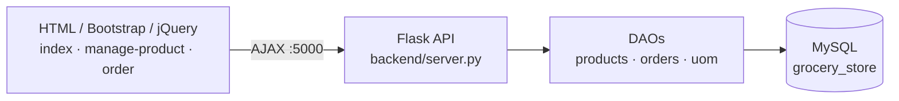

# Grocery Store Management System (Flask + MySQL)

A three-tier web application for a small grocery store: manage products and units of measure, place orders and
view order history.

Built by following the **codebasics** "Python projects — grocery web app" tutorial; the exercise list below is the
tutorial's suggested extension work.


## Architecture



| Endpoint | Method | Purpose |
| --- | --- | --- |
| `/getProducts` | GET | list products with unit names |
| `/getUOM` | GET | list units of measure |
| `/insertProduct` | POST | add a product |
| `/deleteProduct` | POST | delete a product |
| `/insertOrder` | POST | save an order and its line items |
| `/getAllOrders` | GET | list orders with line items |

## Setup

1. Install MySQL and create the database:

   ```bash
   mysql -u root -p < database/schema.sql
   ```

2. Install Python dependencies and set the database credentials (template in `.env.example`):

   ```bash
   pip install -r requirements.txt
   export DB_USER=root DB_PASSWORD='your-password' DB_HOST=127.0.0.1 DB_NAME=grocery_store
   ```

3. Start the API and open the UI:

   ```bash
   cd backend && python server.py      # http://127.0.0.1:5000
   ```

   Then open `index.html` in a browser.

Tests (no database needed): `pytest -q`.

## Exercises (from the tutorial, open)

1. Products: add an **edit** button next to delete.
2. Products: form to add a new unit of measure (e.g. cubic metre) — backend and UI.
3. Orders: validate customer name, item and quantity on the order form.
4. Orders: editing an item's total price does not update the grand total.
5. Orders: a **view** button that shows an order's line items.

## Repository structure

```
backend/          Flask server and data-access objects
database/         schema.sql (reconstructed from the DAO queries)
css/, js/, images/, *.html    front end
tests/            DAO tests with a fake connection
```
